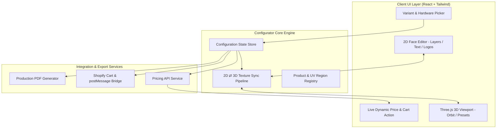

# Interactive 3D Product Configurator — Custom Canopy Tent

A high-performance, modular **3D & 2D Product Configurator** built with **React**, **TypeScript**, and **Three.js / WebGL**. Designed as an embeddable e-commerce customization engine inspired by the [MVP Visuals 10x10 Custom Canopy Tent Configurator](https://mvpvisuals.com/products/10x10-custom-canopy-tent), featuring real-time 2D/3D texture synchronization, a decoupled dynamic pricing service, a Shopify Cart integration pipeline, and automated production-ready PDF proof generation.

---

## 📑 Table of Contents

- [Overview & Live Demo](#-overview--live-demo)
- [Key Features](#-key-features)
- [System Architecture](#-system-architecture)
- [2D ⇄ 3D Synchronization Engine](#-2d--3d-synchronization-engine)
- [Product-Agnostic Configuration Schema](#-product-agnostic-configuration-schema)
- [Shopify & Dynamic Pricing Integration](#-shopify--dynamic-pricing-integration)
- [Production PDF Generator](#-production-pdf-generator)
- [Architecture & Technical Decisions](#-architecture--technical-decisions)
  - [Why React + TS + WebGL Embed vs. Next.js SSR?](#why-react--ts--webgl-embed-vs-nextjs-ssr)
  - [Iframe & postMessage Protocol](#iframe--postmessage-protocol)
- [Performance & Optimization](#-performance--optimization)
- [Directory Structure](#-directory-structure)
- [Getting Started](#-getting-started)

---

## 🌟 Overview & Live Demo

Customizable outdoor canopy tents require intricate branding across multiple printable zones: **4 roof peaks** and **4 valance skirts**, along with hardware choices (frame materials, sandbags, roller bags) and size variants (5'x5', 6.5'x6.5', 8'x8', 10'x10').

This application solves the core engineering challenges of interactive 3D commerce:
1. **Bi-directional visual synchronization:** Customers design on a flat 2D canvas (uploading logos, formatting text, adjusting colors and transforms) and see changes live on the 3D model in real time (and vice-versa).
2. **Schema-driven reusability:** The configurator is completely product-agnostic; swapping the configuration JSON enables custom table covers, flags, or apparel without changing core code.
3. **Turnkey Shopify integration:** Calculates dynamic line-item pricing through an API service layer and dispatches valid `/cart/add.js` payloads via an iframe postMessage bridge.
4. **Manufacturing-ready handoff:** Compiles a production-ready PDF containing multi-angle 3D renders, flat unwrap print layouts, hex color specs, and a Bill of Materials (BOM).

---

## ✨ Key Features

- **Interactive 3D Viewport:**
  - Smooth OrbitControls with bounded pitch and distance.
  - Camera preset transitions (Front, Back, Left, Right, Isometric, Top).
  - Multi-variant GLB switching (5x5, 6.5x6.5, 8x8 models) preserving active customizations.
  - Realistic lighting with environmental HDR map, soft directional shadows, and PBR fabric bump/normal mapping.
- **Independent Section Customization (8 Zones):**
  - **4 Peaks:** Front Peak, Back Peak, Left Peak, Right Peak.
  - **4 Valances:** Front Valance, Back Valance, Left Valance, Right Valance.
  - Base canopy fabric color picker with instant visual feedback.
- **2D Graphic Editor:**
  - Upload raster logos (PNG, JPG, SVG) with transparent background support.
  - Interactive transform handles: drag, scale, rotate, and center.
  - Text engine: font family, font size, fill color, alignment, and letter spacing.
  - Layer management: reorder layers (bring forward / send backward), toggle visibility, and delete.
- **3D-to-2D Interactive Raycasting:**
  - Clicking directly on any tent face in the 3D scene automatically selects that face in the 2D editor and rotates the camera to face it directly.
- **Dynamic Pricing Engine:**
  - Variant base prices (5x5: \$429, 6.5x6.5: \$499, 8x8: \$549).
  - Hardware tier upgrades (Standard Steel vs. Heavy-Duty Hex Aluminum 40mm).
  - Per-location custom print surcharges (e.g., base includes 1 print; additional peaks/valances add dynamic printing fees).
  - Add-on accessory options (heavy sandbag weights, roller carry bag).
- **Shopify Cart Integration & Iframe Bridge:**
  - Formats standard Shopify line-item properties (`_config_id`, `_pdf_url`, `Customization Summary`, `Preview Thumbnail`).
  - Bi-directional `postMessage` event architecture for embedding inside Shopify Liquid themes or Headless storefronts.
- **Automated Production PDF Export:**
  - High-resolution multi-angle 3D WebGL snapshots (Isometric, Front elevation, Back elevation).
  - 2D flat unwrap template showing artwork placement with measurement guides.
  - Complete order details, BOM, hex color breakdown, and manufacturing approval sign-off.

---

## 🏗 System Architecture



---

## 🔄 2D ⇄ 3D Synchronization Engine

A central requirement is real-time visual parity between 2D customization and 3D preview without frame drops or memory leaks.

```
┌────────────────────────────────────────────────────────┐
│                   Active 2D Face Editor                │
│   (e.g., Front Peak: 1024 x 1024 virtual canvas)       │
│   - Background Color                                   │
│   - Vector/Raster Layers (Uploaded Logos, Text)        │
└───────────────────────────┬────────────────────────────┘
                            │
                            ▼ (Composite on change)
┌────────────────────────────────────────────────────────┐
│         Master UV Composite Canvas (2048 x 2048)       │
│   Bakes all 8 sections into GLB UV texture atlas:      │
│   - Front Peak (0°)    -> U: [0.260, 0.740], V: [0.535, 0.860]│
│   - Front Valance (0°) -> U: [0.260, 0.740], V: [0.860, 0.945]│
│   - Right Peak (-90°)  -> U: [0.535, 0.860], V: [0.260, 0.740]│
│   - Right Valance (-90°)-> U: [0.860, 0.945], V: [0.260, 0.740]│
│   - Back Peak (180°)   -> U: [0.260, 0.740], V: [0.140, 0.465]│
│   - Back Valance (180°)-> U: [0.260, 0.740], V: [0.055, 0.140]│
│   - Left Peak (90°)    -> U: [0.140, 0.465], V: [0.260, 0.740]│
│   - Left Valance (90°) -> U: [0.055, 0.140], V: [0.260, 0.740]│
└───────────────────────────┬────────────────────────────┘
                            │
                            ▼ (texture.needsUpdate = true)
┌────────────────────────────────────────────────────────┐
│             Three.js WebGL Texture Pipeline            │
│   fabric_Mat.map = new THREE.CanvasTexture(canvas)     │
│   * Retains native Normal & Roughness PBR maps *       │
└───────────────────────────┬────────────────────────────┘
                            │
                            ▼ (Raycast on click)
┌────────────────────────────────────────────────────────┐
│              3D-to-2D Reverse Raycasting               │
│   Clicking a 3D mesh face inspects intersection UVs,   │
│   identifies the section, and opens it in 2D editor.   │
└────────────────────────────────────────────────────────┘
```

### Key Engineering Details:
1. **Atlas Texture Baking:** The 3D GLB fabric mesh uses a single PBR material (`fabric_Mat`). A 2048x2048 offscreen master canvas acts as the texture atlas. When any face is edited in 2D, its contents are projected into its corresponding UV coordinates on the master canvas.
2. **60 FPS Debounced Updates:** Layer transforms (dragging, scaling, rotating) update the local 2D editor canvas at 60 FPS. The composite update to the Three.js `CanvasTexture` is throttled using `requestAnimationFrame` to avoid unnecessary GPU texture uploads.
3. **Preserving PBR Fabric Realism:** The configurator updates only the material's `map` (diffuse base color). The underlying **Normal Map** (`fabric_Mat_Normal`) and **Roughness Map** (`fabric_Mat_Metallic-Roughness`) from the 3D model are preserved, ensuring the tent displays authentic fabric creases, weave texture, and realistic lighting reflections.

---

## 📦 Product-Agnostic Configuration Schema

The architecture is built around a generic, declarative product schema. Any customizable 3D product (tents, banners, tablecloths) can be loaded by defining its sections and UV regions:

```typescript
// types/product.ts

export type UVRegion = {
  uMin: number;
  uMax: number;
  vMin: number;
  vMax: number;
};

export type PrintableSection = {
  id: string;               // e.g., 'front_peak', 'front_valance'
  name: string;             // "Front Peak"
  category: 'peak' | 'valance' | 'wall';
  uvRegion: UVRegion;       // Mapped coordinates in texture atlas
  aspectRatio: number;      // 2D canvas aspect ratio
  rotation?: number;        // Rotation in degrees (0, 90, 180, -90)
  cameraView: {
    position: [number, number, number];
    target: [number, number, number];
  };
  printCost: number;
};

export type ProductVariant = {
  id: string;               // "tent-5x5", "tent-8x8"
  name: string;             // "8' x 8' Commercial Tent"
  modelUrl: string;         // Path to .glb asset
  basePrice: number;
  dimensions: { width: string; depth: string; height: string };
};

export type ProductDefinition = {
  id: string;
  name: string;
  description: string;
  variants: ProductVariant[];
  availableColors: { name: string; hex: string; pantone?: string }[];
  hardwareOptions: { id: string; name: string; price: number; category: 'frame' | 'accessory' }[];
  sections: PrintableSection[];
};
```

### Customer Configuration State (Serializable JSON):

```json
{
  "productId": "canopy-tent",
  "variantId": "tent-8x8",
  "baseColor": "#1E3A8A",
  "hardware": {
    "frameType": "hex-aluminum",
    "sandbags": true,
    "rollerBag": true
  },
  "sections": {
    "front_peak": {
      "layers": [
        {
          "id": "layer_1",
          "type": "image",
          "content": "data:image/png;base64,...",
          "x": 512,
          "y": 512,
          "scale": 1.0,
          "rotation": 0
        },
        {
          "id": "layer_2",
          "type": "text",
          "content": "SUMMER FESTIVAL 2026",
          "fontFamily": "Inter, sans-serif",
          "fontSize": 48,
          "color": "#FFFFFF",
          "x": 512,
          "y": 750
        }
      ]
    }
  }
}
```

---

## 🛒 Shopify & Dynamic Pricing Integration

### 1. Dynamic Pricing Service API
Pricing calculations are completely decoupled from UI components. The `PricingService` exposes an asynchronous interface simulating a backend pricing microservice or CRM endpoint:

```typescript
export class PricingService {
  async calculatePrice(config: CustomerConfiguration): Promise<PricingBreakdown> {
    // Simulates an API call with latency
    const variant = getVariant(config.variantId);
    const base = variant.basePrice;

    // Hardware upgrades
    let hardwareCost = 0;
    if (config.hardware.frameType === 'hex-aluminum') hardwareCost += 90;
    if (config.hardware.sandbags) hardwareCost += 45;
    if (config.hardware.rollerBag) hardwareCost += 55;

    // Dynamic print surcharges per active custom section
    const customizedCount = countCustomizedSections(config.sections);
    const printCost = customizedCount * 35.00; // $35/custom section

    return {
      basePrice: base,
      hardwareCost,
      printCost,
      customizedSectionCount: customizedCount,
      total: base + hardwareCost + printCost,
      currency: 'USD'
    };
  }
}
```

### 2. Shopify Cart Payload (`/cart/add.js`)
When the customer clicks **"Add to Cart"**, the configuration is converted into a standard Shopify cart line-item payload:

```json
{
  "items": [
    {
      "id": 48192019482012,
      "quantity": 1,
      "properties": {
        "_config_id": "c9a4b821-3e42-4f91-88c2-28e20f8d1c91",
        "_pdf_summary_url": "https://cdn.example.com/proofs/c9a4b821.pdf",
        "_render_preview": "data:image/png;base64,...",
        "Size": "8' x 8' Custom Tent",
        "Frame": "Commercial 40mm Hex Aluminum",
        "Fabric Color": "Navy Blue (#1E3A8A)",
        "Custom Print Locations": "Front Peak, Front Valance (2 sections)",
        "Accessories": "Sandbag Weights (Set of 4), Heavy-Duty Roller Bag"
      }
    }
  ]
}
```

---

## 📄 Production PDF Generator

The application includes an automated client-side vector/raster PDF generation engine powered by `jsPDF`:

1. **Multi-Angle 3D Snapshots:** Automatically captures high-resolution WebGL renders from multiple camera angles:
   - Isometric perspective (Front-Right hero view)
   - Front elevation view
   - Back elevation view
2. **2D Flat Print Layout Proof:** Generates unwrap proof sheets for print operators, detailing exact dimensions, safe margins, and graphic placements.
3. **Artwork & Ink Specifications:** Lists all Pantone/HEX color codes, font families, text strings, and uploaded image resolutions for print readiness.
4. **Order Summary & Sign-off:** Complete Bill of Materials (BOM), pricing breakdown, and manufacturing approval signature line.

---

## 💡 Architecture & Technical Decisions

### Why React + TS + WebGL Embed vs. Next.js SSR?

In modern e-commerce engineering, **3D configurators are separated from the main storefront**:
- **Storefront PDP (Next.js / Shopify Liquid):** Handles SEO, OpenGraph tags, schema.org product metadata, and server-side rendering for search engine crawlers.
- **Configurator Widget (React + WebGL):** Runs 100% on the client. WebGL requires a GPU context, DOM elements, and high-frequency event loops that cannot execute on a server.
- **Protecting Core Web Vitals:** Loading multi-megabyte 3D bundles and GLB models into the initial SSR HTML harms **LCP (Largest Contentful Paint)** and **INP (Interaction to Next Paint)**. Running the configurator as an on-demand embed or isolated iframe keeps the host store fast and high-ranking while delivering smooth 60 FPS 3D customization.

### Iframe & postMessage Protocol

To support embedding into Shopify stores or third-party retailer sites, the app implements a secure `postMessage` protocol:

```javascript
// Configurator (Inside iframe) -> Parent Storefront
window.parent.postMessage({
  type: 'SHOPIFY_ADD_TO_CART',
  payload: cartPayload
}, '*');

// Parent Storefront -> Configurator (Inside iframe)
iframeWindow.postMessage({
  type: 'SET_INITIAL_CONFIG',
  payload: { variantId: 'tent-8x8', baseColor: '#FFFFFF' }
}, '*');
```

---

## ⚡ Performance & Optimization

- **Texture Atlas Sharing:** All 8 customized zones are composited onto a single 2048x2048 canvas, minimizing GPU draw calls and avoiding material switching overhead.
- **GPU Resource Disposal:** Textures, geometries, and materials are programmatically tracked and disposed of upon variant switches to prevent WebGL context loss and browser memory leaks.
- **Debounced Composite Bakes:** Rapid user interactions (typing, dragging sliders) only re-render the 2D canvas locally, queuing a debounced texture upload to WebGL via `requestAnimationFrame`.
- **GLB Asset Optimization:** 3D tent models feature clean topology with separated metal mechanisms and fabric meshes, allowing fast mesh cloning and instant variant transitions.

---

## 📁 Directory Structure

```
assignment_vertical_tech_3d/
├── public/
│   └── models/
│       ├── Tent_5_5.glb           # 5x5 ft Tent Model
│       ├── Tent_6_5_6_5.glb       # 6.5x6.5 ft Tent Model
│       └── Tent_8_8.glb           # 8x8 ft Tent Model
├── src/
│   ├── components/
│   │   ├── 3d/
│   │   │   ├── Canvas3D.tsx       # Three.js Canvas, lighting, shadows & texture sync
│   │   │   ├── ModelLoader.tsx    # GLTF loader, PBR material isolation & centering
│   │   │   ├── CameraRig.tsx      # Smooth camera preset transitions & snapshot capture
│   │   │   └── ViewControls.tsx   # View angle presets, reset camera & 360° spin
│   │   ├── 2d/
│   │   │   └── FaceEditor2D.tsx   # Interactive 2D canvas, layers, text, logos & transforms
│   │   ├── ui/
│   │   │   ├── SectionTabs.tsx    # 8 printable zone selector tabs
│   │   │   ├── VariantPicker.tsx  # 5x5, 6.5x6.5, 8x8 size switcher
│   │   │   ├── ColorPicker.tsx    # Palette swatches & react-colorful custom picker
│   │   │   ├── HardwareSelector.tsx # Frame tiers & accessory options
│   │   │   ├── PriceActionBar.tsx # Live subtotal, dynamic price breakdown drawer & actions
│   │   │   ├── ShopifyPayloadModal.tsx # Shopify /cart/add.js payload inspector
│   │   │   └── ThemeToggle.tsx    # Light/Dark DaisyUI theme toggle
│   │   └── embed/
│   │       └── ShopifyHostMock.tsx # Host Shopify PDP simulation with iframe communication
│   ├── config/
│   │   └── tentProduct.ts         # Product definition, UV zones & camera targets
│   ├── pages/
│   │   ├── ConfiguratorPage.tsx   # Main standalone configurator view
│   │   ├── ShopifyStorePage.tsx   # Mock parent Shopify PDP embedding iframe
│   │   └── NotFoundPage.tsx       # 404 handler
│   ├── services/
│   │   ├── pricingService.ts      # Mock dynamic pricing microservice API
│   │   ├── shopifyService.ts      # Shopify Cart API & postMessage bridge
│   │   └── pdfService.ts          # jsPDF production spec sheet generator
│   ├── store/
│   │   ├── useConfiguratorStore.ts # Central product, variant & customization state
│   │   ├── useThemeStore.ts       # DaisyUI light/dark theme persistence
│   │   └── useCanvasStore.ts      # Active 2D/3D interaction state
│   ├── types/
│   │   └── configurator.ts        # Domain types & schema definitions
│   ├── utils/
│   │   ├── textureAtlas.ts        # Master 2048x2048 texture atlas composite engine
│   │   └── assetPaths.ts          # Base URL & model asset resolution
│   ├── App.tsx
│   └── main.tsx
└── README.md
```

---

## 🚀 Getting Started

### Prerequisites
- Node.js (v18.0 or higher)
- npm or pnpm

### Installation
```bash
# Clone the repository
git clone <repo-url>
cd assignment_vertical_tech_3d

# Install dependencies
npm install

# Start development server
npm run dev
```

### Build for Production
```bash
npm run build
npm run preview
```

---

## ⚖️ Evaluation Criteria Mapping

| Evaluation Criteria | Where to Find in Codebase |
|---|---|
| **Code Quality & Architecture** | Modular domain services in `src/services/`, clean separation of 2D/3D logic, typed schemas with TypeScript `type` in `src/types/configurator.ts` |
| **2D/3D Synchronization** | `src/utils/textureAtlas.ts`, `src/components/3d/Canvas3D.tsx` & `src/components/2d/FaceEditor2D.tsx` |
| **Dynamic Pricing Logic** | `src/services/pricingService.ts` & `src/components/ui/PriceActionBar.tsx` |
| **Shopify Integration** | `src/services/shopifyService.ts` & `src/components/ui/ShopifyPayloadModal.tsx` (`/cart/add.js` payload) |
| **Iframe Embeddability** | `src/components/embed/ShopifyHostMock.tsx` & `src/pages/ShopifyStorePage.tsx` (`postMessage` communication bridge) |
| **Production PDF Summary** | `src/services/pdfService.ts` (Multi-angle 3D captures + BOM + print specifications) |
| **Reusability** | Declarative product registry in `src/config/tentProduct.ts` |
